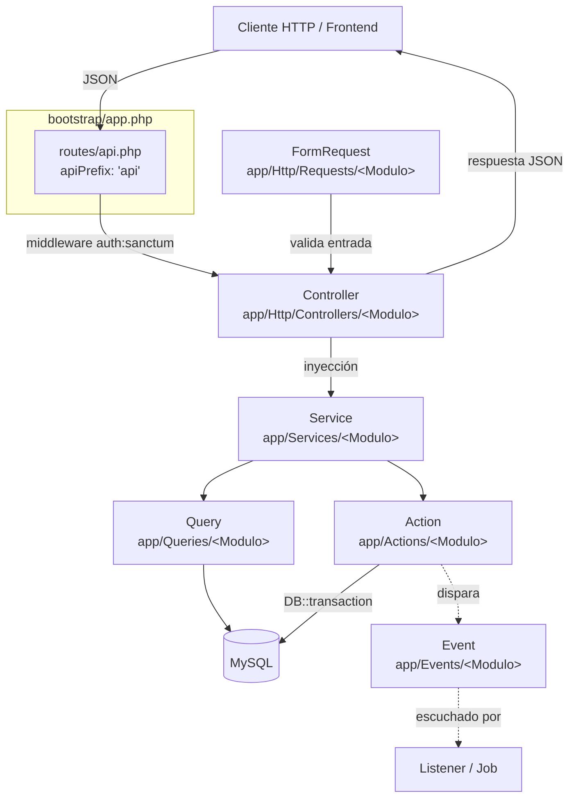

# 01 · Arquitectura

## 🎯 Visión general

`app-ventas` es una **API JSON monolítica** construida sobre Laravel 12. No expone vistas Blade salvo un pequeño `welcome` raíz en `routes/web.php`. Toda la superficie de negocio vive bajo el prefijo `api/v1` y se protege con `auth:sanctum` excepto los endpoints públicos de `register` y `login`.

La arquitectura interna se inspira en una variante de **Service Layer + Action + Query**:

- **Controller** recibe la request, delega y formatea respuestas JSON uniformes.
- **Service** orquesta dependencias (Actions + Queries) y aísla al Controller de la lógica.
- **Query** encapsula lecturas (una clase por caso: listar, buscar por id).
- **Action** encapsula escrituras (crear, actualizar, eliminar), normalmente dentro de `DB::transaction()` cuando afectan a varias tablas.
- **FormRequest** valida entradas con reglas tipadas y mensajes en español.

## 🧱 Diagrama de capas



## 🧩 Principios aplicados

| Principio | Cómo se manifiesta |
|-----------|---------------------|
| **Separación de responsabilidades** | Controller delega en Service, Service en Actions/Queries. |
| **Tipado fuerte** | Promoted properties en constructor, `: JsonResponse`, `: Producto`. |
| **Validación aislada** | `FormRequest` por endpoint store/update con `failedValidation` propio. |
| **Eloquent primero** | `Model::query()` con relaciones tipadas, sin `DB::` salvo transacciones. |
| **Idempotencia y atomicidad** | `DB::transaction()` en `CreateVentaAction` al actualizar stock y registrar movimiento. |
| **Respuestas uniformes** | Bloques `try/catch` en controllers → `404`, `422`, `500` con shape estable. |
| **Eager loading** | `$venta->load(['cliente', 'usuario', 'detalleVentas.producto'])`. |
| **Eventos como hook** | `app/Events/Categorias/*` ya definidos, listos para listeners. |

## 📐 Capas en detalle

### 1. Rutas (`routes/api.php`)

Todas las rutas del API están protegidas por `auth:sanctum` excepto `register` y `login`. Se usan prefijos anidados (`api` → `v1` → `<recurso>`) para mantener el versionado.

### 2. Form Requests (`app/Http/Requests/<Modulo>/`)

- `Store<Modulo>Request.php` para POST.
- `Update<Modulo>Request.php` para PUT.
- Sobrescriben `failedValidation()` para devolver `422` con shape JSON consistente: `{ success:false, message:"...", errores:"..." }`.

### 3. Controllers (`app/Http/Controllers/<Modulo>/`)

- Inyectan el Service por constructor (property promotion).
- Métodos `index`, `show`, `store`, `update`, `destroy` con retorno `: JsonResponse`.
- Cada método envuelve la llamada en `try/catch (Throwable $e)`, devolviendo `404` para `ModelNotFoundException` y `500` para el resto.

### 4. Services (`app/Services/<Modulo>/`)

- Inyectan todas las Queries y Actions del módulo.
- Métodos públicos delgados que solo delegan (`getAll`, `getById`, `create`, `update`, `delete`).
- En `Ventas` reciben además `int $idUsuario` para guardar trazabilidad.

### 5. Queries (`app/Queries/<Modulo>/`)

- Una clase por caso de lectura. Nombre estándar: `GetAllX`, `GetXById`.
- Método único `handle(...args)`.
- Permiten joins enriquecidos (ej. `GetAllProductos` une con `categorias` para devolver `c.nombre as categoria`).

### 6. Actions (`app/Actions/<Modulo>/`)

- Una clase por caso de escritura. Nombre estándar: `CreateXAction`, `UpdateXAction`, `DeleteXAction`.
- Método único `handle(...args)`.
- Cuando toca varias tablas (ej. ventas + inventario) usan `DB::transaction()`.

### 7. Models (`app/Models/`)

- `$fillable` declarado.
- Relaciones Eloquent con type-hints (`BelongsTo`, `HasMany`).
- Casts definidos en método `casts()` (Laravel 12).

### 8. Events (`app/Events/<Modulo>/`)

- Capa preparada pero infrautilizada. Existe un evento por operación CRUD del módulo Categorías como referencia (`CategoriaCreadaEvent`, `CategoriaActualizadaEvent`, `CategoriaEliminadaEvent`).

### 9. Imports (`app/Imports/`)

- `ProductosImport.php` se invoca desde `ProductoService::importar()` con `Maatwebsite\Excel\Facades\Excel::import(new ProductosImport, $file)`.

## 📚 Referencias reales en el código

| Concepto | Archivo de ejemplo |
|----------|---------------------|
| Controller con try/catch uniforme | `app/Http/Controllers/Productos/ProductoController.php` |
| Service que orquesta todo | `app/Services/Productos/ProductoService.php` |
| Query con join enriquecido | `app/Queries/Ventas/GetAllVentas.php` |
| Action transaccional | `app/Actions/Ventas/CreateVentaAction.php` |
| FormRequest con mensajes en español | `app/Http/Requests/Productos/StoreProductoRequest.php` |
| Middleware y excepciones JSON | `bootstrap/app.php` |

## 🧭 Convenciones de respuesta

```jsonc
// 200 OK
[ /* o */ { "...": "..." } ]

// 201 Created
{ "...": "..." }

// 401 Unauthorized (vía bootstrap/app.php)
{ "success": false, "message": "No autenticado...", "error": "Unauthorized" }

// 404 Not Found
{ "error": "Recurso no encontrado.", "message": "El recurso con el ID especificado no existe." }

// 422 Validation Error
{ "success": false, "message": "Campos requeridos pendientes", "errores": "El nombre es obligatorio. | ..." }

// 500 Server Error
{ "error": "Error al ...", "message": "<excepción>" }
```
