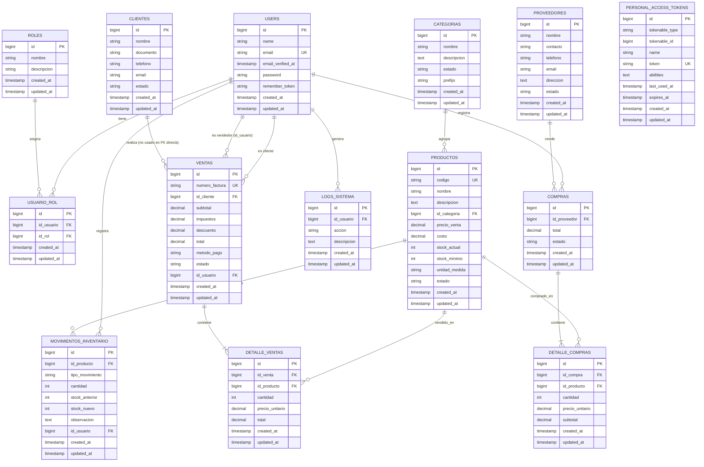

# 03 · Modelos y base de datos

## 🧭 Diagrama entidad–relación



> ⚠️ El diagrama refleja las migraciones reales. El modelo `Venta` apunta `id_cliente` a `users.id` (no a `clientes.id`), aunque existe la tabla `clientes` sin endpoints.

## 📋 Descripción por tabla

### `users`
- Campos estándar de Laravel (con `name` y `email`).
- Cast `password` → `hashed` definido en `User::casts()`.
- Tokens personales Sanctum en `personal_access_tokens` (relación automática vía `HasApiTokens`).

### `roles` y `usuario_rol`
- Roles sembrados: `admin`, `cliente`, `vendedor` (`RoleSeeder`).
- Pivote `usuario_rol` con `created_at`/`updated_at`, expuesta en `Role::users()` con `withPivot('created_at', 'updated_at')->withTimestamps()`.

### `categorias`
- Añadidos en migración posterior: campo `prefijo` (usado por `CreateProductoAction` para autocomponer `codigo = "{prefijo}-####"`).
- `estado` típicamente `activo` / `inactivo`.

### `productos`
- `codigo` único, **nullable** (migración `2026_05_12_191918_make_codigo_nullable_in_productos_table.php` permite generar el código en backend).
- Stock administrado por `stock_actual` y `stock_minimo`.
- Relación con `categorias` (`id_categoria`).

### `clientes`
- Tabla presente pero **sin endpoints en `routes/api.php`**. Tampoco existe `ClienteController.php`.
- Se recomienda crear el módulo siguiendo `docs/07-como-crear-un-nuevo-modulo.md`.

### `proveedores`
- Campos completos de contacto. CRUD activo en `api/v1/proveedores`.

### `movimientos_inventario`
- Cada venta confirmada o ajuste crea un registro con `stock_anterior` y `stock_nuevo`.
- Soporta cualquier `tipo_movimiento` (ej. `venta`, `compra`, `ajuste_inventario`).
- Añadido `observacion` en migración posterior `2026_03_17_184108_…`.

### `ventas` y `detalle_ventas`
- `numero_factura` único, generado por `CreateVentaAction::generarNumeroFactura()` (`FACT-00000001`).
- Subtotal, impuestos, descuento y total se calculan al crear.
- `estado` ∈ `pendiente` (default), `completado`, `cancelado`.
- Cuando `estado = completado` se descuenta stock y se registra movimiento.

### `compras` y `detalle_compras`
- `id_proveedor` FK a `proveedores`.
- `detalle_compras` tiene `precio_unitario` y `subtotal` por línea.

### `logs_sistema`
- Auditoría genérica (`id_usuario`, `accion`, `descripcion`).
- Sin endpoints todavía; pensada para integrarse con `LogSistema::create([...])` desde Actions.

### `personal_access_tokens`
- Tabla de Sanctum donde se almacenan los tokens de acceso a la API.

## 🔗 Relaciones Eloquent clave

```php
// Producto
$categoria            = $producto->categoria;
$movimientos          = $producto->movimientosInventario;
$detallesVenta        = $producto->detalleVentas;
$detallesCompra       = $producto->detalleCompras;

// Venta
$cliente              = $venta->cliente;       // User
$usuarioVendedor      = $venta->usuario;       // User
$detalles             = $venta->detalleVentas; // hasMany DetalleVenta
// carga típica usada en controllers:
$venta->load(['cliente', 'usuario', 'detalleVentas.producto']);

// User (implícito desde Role por la relación belongsToMany)
$roles = $user->roles;    // vía belongsToMany
```

## ⚠️ Cambios recientes a tener en cuenta

| Migración | Efecto |
|-----------|--------|
| `2026_03_16_205524_create_personal_access_tokens_table.php` | Habilita Sanctum (necesaria para `auth:sanctum`). |
| `2026_03_17_184108_add_observacion_to_movimientos_inventario_table.php` | Permite describir el motivo del movimiento. |
| `2026_05_12_164251_add_prefijo_to_categorias_table.php` | Habilita la generación de `codigo` automático en productos. |
| `2026_05_12_191918_make_codigo_nullable_in_productos_table.php` | Evita validación `unique` previa al autogenerado. |
