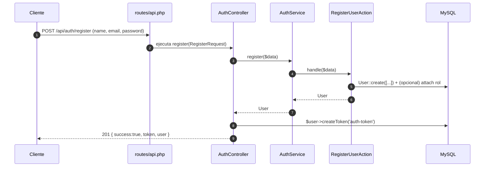
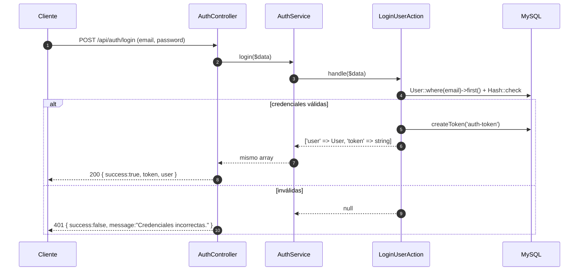
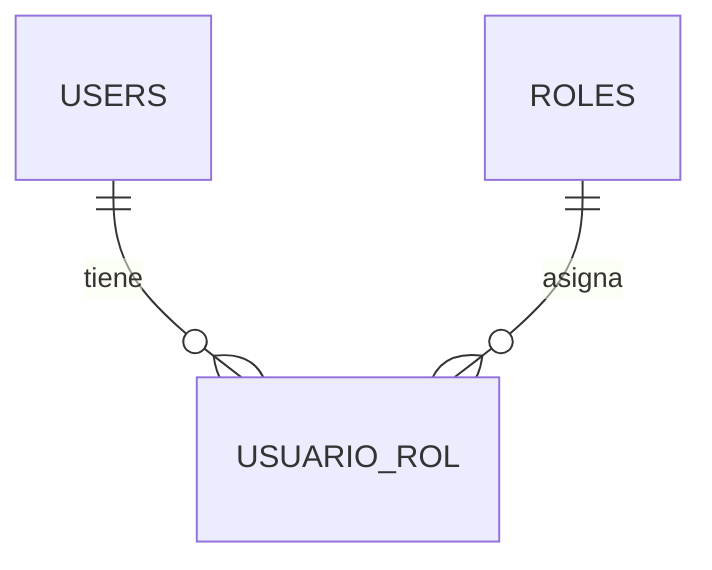

# 04 · Autenticación y roles

La API usa **Laravel Sanctum** con tokens personales. Sólo dos endpoints son públicos: `POST /api/auth/register` y `POST /api/auth/login`. Todo lo demás vive dentro del grupo `Route::middleware('auth:sanctum')`.

## 🔐 Rutas (resumen)

```php
// routes/api.php
Route::prefix('auth')->group(function () {
    Route::post('/register', [AuthController::class, 'register']);
    Route::post('/login',    [AuthController::class, 'login']);
});

Route::middleware('auth:sanctum')->group(function () {
    Route::prefix('auth')->group(function () {
        Route::post('/logout', [AuthController::class, 'logout']);
        Route::get('/me',       [AuthController::class, 'me']);
    });

    Route::prefix('v1')->group(function () {
        // ... CRUD ...
    });
});
```

## 📦 Componentes

| Capa | Archivo | Rol |
|------|---------|-----|
| Controller | `app/Http/Controllers/Auth/AuthController.php` | Recibe request, devuelve JSON con token. |
| Form Requests | `app/Http/Requests/Auth/{Login,Register}Request.php` | Validan payload. |
| Service | `app/Services/Auth/AuthService.php` | Orquesta `LoginUserAction` y `RegisterUserAction`. |
| Actions | `app/Actions/Auth/{LoginUser,RegisterUser}Action.php` | Lógica de creación / verificación. |
| Modelo | `app/Models/User.php` | Usa `HasApiTokens`, `HasFactory`, `Notifiable`. Cast `password => 'hashed'`. |
| Modelo | `app/Models/Role.php` | `belongsToMany` con `users` vía pivote `usuario_rol`. |
| Migraciones | `2024_01_01_000001_create_roles_table.php` y `…_000002_create_usuario_rol_table.php` | Definen roles. |
| Seeder | `database/seeders/RoleSeeder.php` | Crea `admin`, `cliente`, `vendedor`. |

## 🔁 Flujo de registro



## 🔁 Flujo de login



## 🧑‍🤝‍🧑 Roles y `usuario_rol`



El proyecto usa la tabla pivote `usuario_rol` con timestamps. La asignación desde seed:

```php
// RoleSeeder.php
$roles = [
    ['nombre' => 'admin',     'descripcion' => 'Administrador con acceso total al sistema'],
    ['nombre' => 'cliente',   'descripcion' => 'Cliente que puede realizar compras'],
    ['nombre' => 'vendedor',  'descripcion' => 'Vendedor que gestiona ventas y productos'],
];
```

### Asignar un rol al crear un usuario (en `RegisterUserAction`)

```php
$user = User::create([
    'name'     => $data['name'],
    'email'    => $data['email'],
    'password' => bcrypt($data['password']),
]);

// forma 1: usar relación belongsToMany declarada en Role
$user->roles()->attach($rolId);

// forma 2: usar User::find($user->id)->roles()->attach($rolId);
```

## 🧪 Verificar rol en endpoints

Actualmente el proyecto **no aplica policies ni gates** (ver `docs/10-como-anadir-policies-y-gates.md`). Mientras tanto, se puede comprobar manualmente en cualquier controller:

```php
use Illuminate\Support\Facades\Auth;

public function store(StoreVentaRequest $request): JsonResponse
{
    $user = Auth::user();

    if (! $user->roles->pluck('nombre')->contains('vendedor')) {
        return response()->json([
            'success' => false,
            'message' => 'No tiene permisos para registrar ventas.',
        ], 403);
    }

    // ...
}
```

## 🚪 Logout

```php
// AuthController::logout()
$request->user()->currentAccessToken()->delete();

return response()->json([
    'success' => true,
    'message' => 'Sesión cerrada correctamente.',
]);
```

## 🛑 Manejo de no autenticado

Definido en `bootstrap/app.php`:

```php
$exceptions->render(function (AuthenticationException $e, $request) {
    if ($request->expectsJson() || $request->is('api/*')) {
        return response()->json([
            'success' => false,
            'message' => 'No autenticado. Por favor, inicie sesión para continuar.',
            'error'   => 'Unauthorized',
        ], 401);
    }
});
```

## 🧭 Buenas prácticas

1. **No uses `env()`** para tokens ni claves: céntralo en `config/sanctum.php` y usa `config()` en runtime.
2. **Asigna nombres únicos a tokens** (`'auth-token'`, `'mobile-app'`) para poder revocar selectivamente.
3. **Hashea siempre** las contraseñas (`'password' => 'hashed'` en `User::casts()`).
4. **Audita acciones críticas** creando un registro en `logs_sistema` desde las Actions (ver `docs/08-como-anadir-eventos-y-listeners.md`).
